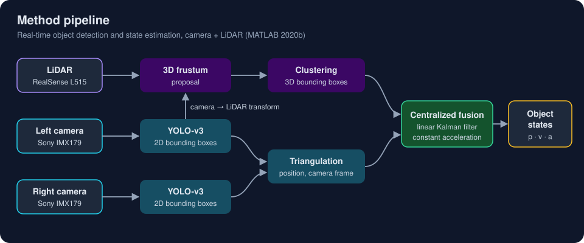
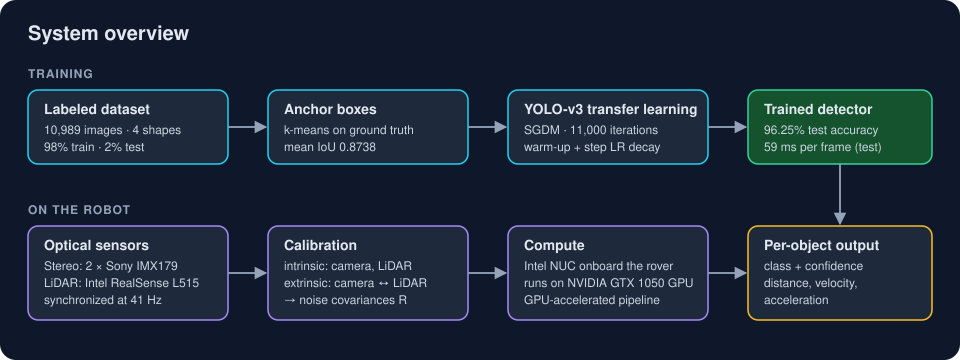
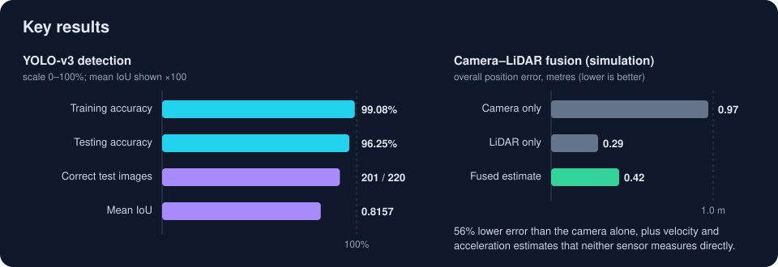
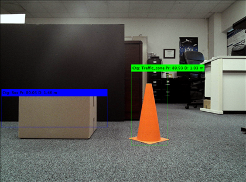
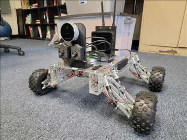

# MS Thesis Defense Slides: Real-time Object Detection and Camera–LiDAR Fusion

**LaTeX Beamer slides for my Master's thesis defense in Aerospace Engineering at The University of Texas at Arlington (June 2021).**

The talk shows how a wheeled robot detects objects in real time with a YOLO-v3 deep neural network and estimates each object's position, velocity and acceleration by fusing a stereo camera with a LiDAR through a Kalman filter. This repository holds two versions of the deck: the one I presented at the defense, and a longer extended version.

[Thesis report (LaTeX)](https://github.com/kamalkimahek14/MS-Thesis-Report) · [Portfolio: kamal-mehta.com](https://kamal-mehta.com) · [Compiled PDFs (Releases)](https://github.com/kamalkimahek14/MS-Thesis-Presentation/releases)

## Which deck is which

| Folder | Status | Frames | Sections |
|---|---|---|---|
| [`presented/`](presented/) | **The version presented at the defense** | 48 | 11 sections, from motivation to future work |
| [`extended/`](extended/) | Longer version with extra detail | 68 | the same 11, plus *Data Preprocessing* and *Testing Results* |

Both decks use the same figures, title page and bibliography. The extended deck adds a section on how the training data was prepared and a full section on test-set results (pie chart, confusion chart and example detections). The presented deck keeps the story tight for a timed talk and folds the key test numbers into *Training Results*.

## The problem

A ground robot that avoids collisions has to know **what** is in front of it and **where** it is, many times per second, on a small onboard computer. Region-based detectors such as R-CNN are accurate but too slow for that budget. A camera alone sees classes well but judges distance poorly; a LiDAR measures distance well but sees no color or texture. The thesis combines a fast single-shot detector with fusion of both sensors to get accurate, real-time object states.

## Approach



1. **Detect** with YOLO-v3, adapted to four shapes (cylinder, traffic cone, pyramid, box) by transfer learning on a labeled dataset of 10,989 images.
2. **Tune** mini-batch size, L2 regularization, learning rate, warm-up and number of iterations to balance bias and variance.
3. **Calibrate** the stereo camera and the LiDAR (intrinsic and extrinsic) to get each sensor's measurement error and the camera-to-LiDAR transform.
4. **Locate** each object twice: by stereo triangulation of the 2D boxes, and by projecting the boxes into the LiDAR point cloud as 3D frustums and clustering them.
5. **Fuse** both measurements in a centralized linear Kalman filter with a constant-acceleration model, which also yields velocity and acceleration.



## Key results

All numbers come from the thesis.

| Result | Value |
|---|---|
| Training / testing accuracy | 99.08% / 96.25% |
| Test images detected correctly | 201 of 220 |
| Mean IoU on the test set | 0.8157 |
| Average detection time (test) | 59 ms per frame |
| Mean IoU of the estimated anchor boxes | 0.8738 |
| Camera intrinsic re-projection error | 0.37 pixels |
| Fused position error in simulation | 0.42 m, 56% lower than the camera alone (0.97 m) |
| Sensor rate on the robot | 41 Hz, camera and LiDAR synchronized |
| Full detection + fusion on GPU | 1.44 s per frame (about 8 s on CPU) |



<p align="center">
  
  
</p>
<p align="center"><sub>Left: live detections labelled with class, confidence and estimated distance. Right: the test robot with the stereo camera, LiDAR and onboard computer.</sub></p>

## My contributions

- Transfer learning of YOLO-v3 with SGDM on a custom labeled dataset, including anchor-box estimation by k-means.
- Iterative hyper-parameter tuning (L2 regularization, learning rate, mini-batch size, epochs, momentum).
- Evaluation of the trained detector on a held-out test set.
- Intrinsic and extrinsic calibration of the stereo camera and LiDAR: measurement errors, covariances and the rigid transform between the two sensor frames.
- A Kalman-filter sensor-fusion framework, first in a MATLAB driving-scenario simulation and then in real time on the robot.
- Everything built in MATLAB 2020b (Deep Learning, Computer Vision, LiDAR, and Sensor Fusion and Tracking toolboxes).

## How to build

You need a LaTeX distribution (TeX Live or MiKTeX) with **Beamer**, **biblatex** and **biber**. Build each deck from its own folder:

```bash
cd presented          # or: cd extended
latexmk -pdf main.tex
```

Without latexmk:

```bash
pdflatex main.tex
biber main
pdflatex main.tex
pdflatex main.tex
```

The output is `main.pdf` in the same folder. Packages used: `beamer` (Madrid theme), `inputenc`, `biblatex`.

## Repository structure

```
MS-Thesis-Presentation/
├── presented/          # deck presented at the defense (48 frames)
│   ├── main.tex
│   ├── ref.bib
│   ├── UTA.png
│   └── Images/         # slide figures
├── extended/           # extended deck (68 frames)
│   ├── main.tex
│   ├── ref.bib
│   ├── UTA.png
│   └── Images/
├── docs/               # README diagrams and photos
├── CITATION.cff
└── README.md
```

## Related

- **[MS-Thesis-Report](https://github.com/kamalkimahek14/MS-Thesis-Report)**: the full thesis these slides summarize.
- **[kamal-mehta.com](https://kamal-mehta.com)**: my portfolio.

## Citation

GitHub shows a *Cite this repository* button built from [`CITATION.cff`](CITATION.cff).

Kamal Mehta. *Object Classification, Detection and State Estimation using YOLO v3 Deep Neural Network and Sensor Fusion of Stereo Camera and LiDAR*. Master's thesis, The University of Texas at Arlington, 2021.
